<table width="100%" cellpadding="10" cellspacing="0">
  <!-- ROW 1: HEADER — Identity + Links (70%) | Visual + CTA (30%) -->
  <tr>
    <td width="70%" align="center" valign="middle">
      <h3>Yomán</h3>
      

        <b>Songwriter · Spoken Word &amp; Indie Narrative · Audio Tinkerer</b>
      

      

        
          <em>Introspective lyrics, non-linear arrangements, and narrative worlds 
          built between words, vocal textures, and code.</em>
        
      

      

        <!-- TODO: Reemplaza o ajusta estos enlaces con tus URLs reales -->
        
        &nbsp;
        
        &nbsp;
        
        &nbsp;
        
        &nbsp;
        
      

    </td>
    <td width="30%" align="center" valign="middle">
      <!-- TODO: Asegúrate de tener este SVG en ./assets/ o reemplázalo por uno propio -->
      
       
      <!-- TODO: Cambia la URL por tu GitHub Pages o archivo de obra -->
      
    </td>
  </tr>

  <!-- ROW 2: CREATIVE FOCUS & CURRENT STAGE (70% / 30%) -->
  <tr>
    <!-- COLUMNA IZQUIERDA (70%): EJES DE TRABAJO MUSICAL Y NARRATIVO -->
    <td width="70%" align="left" valign="middle">
      
<b>CREATIVE AXES</b>

      

        
          
          <b>Lyricism &amp; Meter</b> · <em>Rhyme architecture, spoken cadences, long-form verses</em>
        
      

      

        
          
          <b>Narrative &amp; Worlds</b> · <em>Alienation, shadow themes, visual treatments, scripts</em>
        
      

      

        
          
          <b>Vocal &amp; Arrangement</b> · <em>Subtractive/additive EQ, serial compression, FX sends</em>
        
      

      

        
          
          <b>Audio DSP &amp; Tools</b> · <em>C++ / JUCE experiments, Python ML, custom workflows</em>
        
      

    </td>
    <!-- COLUMNA DERECHA (30%): ETAPA ACTUAL Y FORMA DE TRABAJO -->
    <td width="30%" align="left" valign="middle">
      
<b>NOW</b>

      

        
          
          <b>Cycle:</b> <em>Andrómeda</em>
        
      

      

        
          
          <b>Roots:</b> <em>Automata · Abstracto</em>
        
      

      

        
          
          <b>Process:</b> <em>Drafts · Revisions</em>
        
      

      

        
          
          <b>Status:</b> <em>Writing &amp; Mixing</em>
        
      

    </td>
  </tr>

  <!-- ROW 3: ACTIVITY & METRICS (70% / 30%) -->
  <tr>
    <td width="70%" align="center" valign="middle">
      <!-- TODO: Reemplaza o crea este SVG si quieres mostrar racha/ritmo -->
      
    </td>
    <td width="30%" align="center" valign="middle">
      <!-- TODO: Reemplaza o crea este SVG si quieres mostrar estadísticas -->
      
    </td>
  </tr>

  <!-- ROW 4: TOOLKIT & ECOSYSTEM (70% / 30%) -->
  <tr>
    <td width="70%" align="center" valign="middle">
      <!-- TODO: Reemplaza o crea este SVG de título -->
      
        
      <!-- CAPA 1: WRITING & STRUCTURE -->
      

        &nbsp;&nbsp;&nbsp;
        
        
        &nbsp;&nbsp;&nbsp;&nbsp;&nbsp;
        
        &nbsp;&nbsp;&nbsp;
        
        &nbsp;&nbsp;&nbsp;
        
        &nbsp;&nbsp;&nbsp;
        
      

      <!-- CAPA 2: DAW & AUDIO -->
      

        &nbsp;&nbsp;&nbsp;
        
        
        &nbsp;&nbsp;&nbsp;&nbsp;&nbsp;
        
        &nbsp;&nbsp;&nbsp;
        <!-- TODO: Asegúrate de tener este SVG o usa un ícono de Iconify -->
        
        &nbsp;&nbsp;&nbsp;
        
      

      <!-- CAPA 3: DSP & CODE -->
      

        &nbsp;&nbsp;&nbsp;
        
        
        &nbsp;&nbsp;&nbsp;&nbsp;&nbsp;
        
        &nbsp;&nbsp;&nbsp;
        
        &nbsp;&nbsp;&nbsp;
        
      

      <!-- CAPA 4: VISUALS & WEB -->
      

        &nbsp;&nbsp;&nbsp;
        
        
        &nbsp;&nbsp;&nbsp;&nbsp;&nbsp;
        
        &nbsp;&nbsp;&nbsp;
        
        &nbsp;&nbsp;&nbsp;
        
      

    </td>
    <td width="30%" align="center" valign="middle">
      <!-- TODO: Reemplaza o crea estos SVGs laterales si los mantienes -->
      
        
      
    </td>
  </tr>

  <!-- ROW 5: FOOTER -->
  <tr>
    <td colspan="2" width="100%" align="center" valign="middle">
      <!-- TODO: Reemplaza o crea estos SVGs de cierre -->
      
        
      
    </td>
  </tr>
</table>
